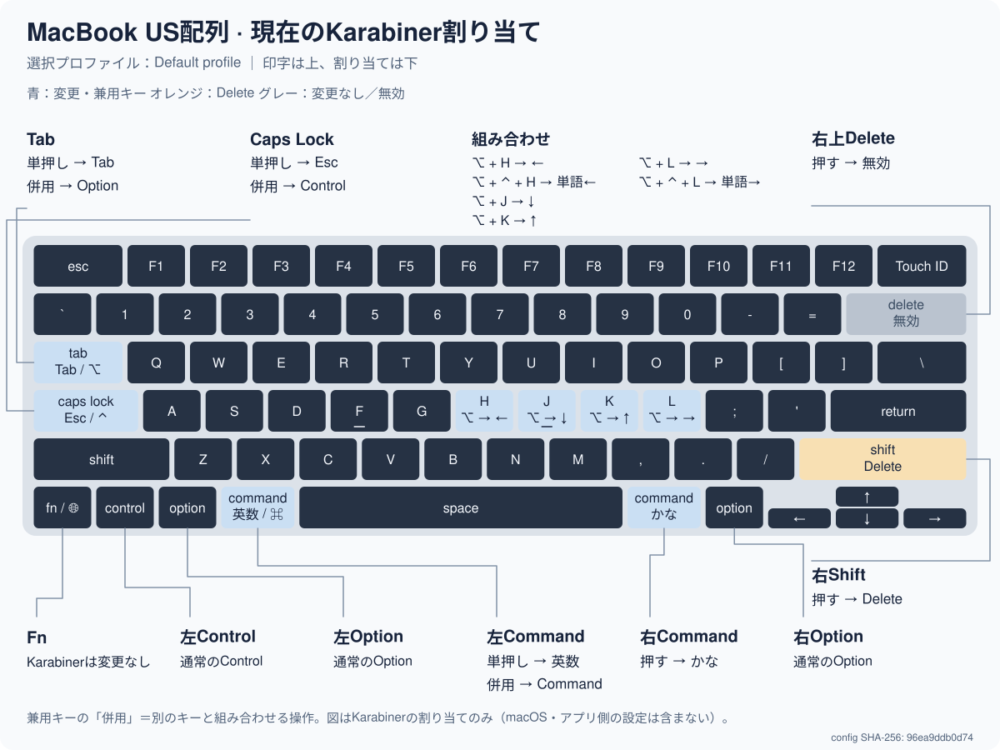

# Dotfiles

新しいMacは、AIエージェントにこのURLと「セットアップして」と伝え、[1コマンドのセットアップ手順](.config/dotfiles/README.md)を使います。開始時に管理者認証を行い、Homebrew直後に権限対象アプリだけ起動し、CLI準備中にもAIが許可設定を進めます。GitHub認証後はvaultや残りのアプリを導入します。その後はエージェントが監視します。[エージェント向け手順](.config/dotfiles/SETUP-AGENT.md)。

[yadm で HOME の個別ファイルを直接追跡します。セットアップ・所有権・日常操作はこちら。](.config/dotfiles/README.md)

## MacBookのキー割り当て

[現在の割り当てと更新方法](.config/karabiner/README.md)。KarabinerのJSONから図と表を生成し、設定と一緒に管理します。

## MacのDock・キーボード設定

初期セットアップの最後に確認なしで自動適用します。単独で適用する場合は `dotfiles macos apply`、戻す場合は `dotfiles macos restore`、確認は `dotfiles macos status`。リポジトリ直下の「Mac-Settings-Apply.command」「Mac-Settings-Restore.command」はダブルクリックでも実行できます。

- Dockに固定するアプリはFinder・Launchpad・システム設定だけ（存在するもの）。
- Dockを自動的に隠し、最近使ったアプリを表示しない。起動中のアプリは終了するまで表示されます。Downloads等は維持します。
- KeyRepeat=1、InitialKeyRepeat=15。

初回適用前の設定を端末内に保存して一括復元できます。Dockは即時再起動し、キーリピートは作業後のログアウト／ログインまたは再起動で反映を確認してください。Macは自動再起動しません。
